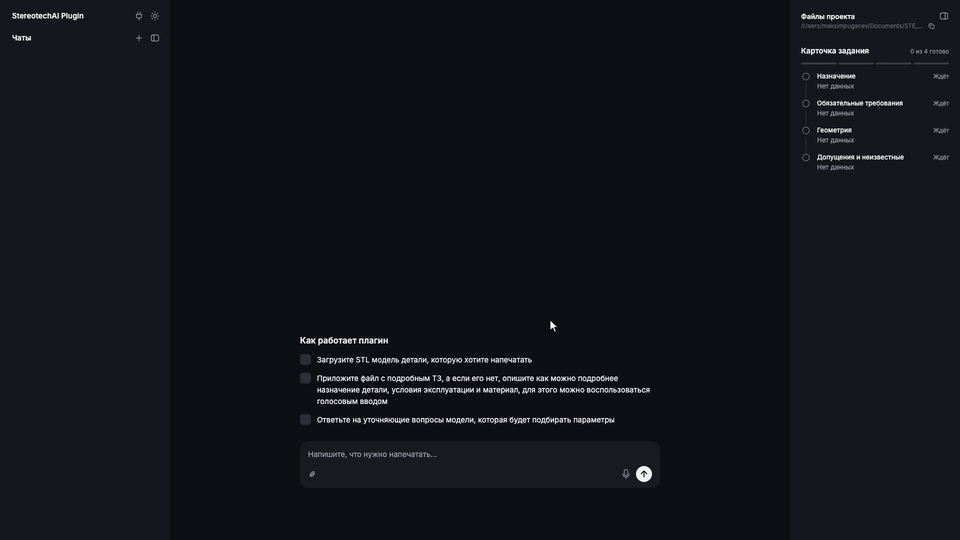

# Loops

ИИ-технолог для гибридного принтера Stereotech Hybrid 530. Работает внутри STE Slicer как плагин AI Assistant. Технолог описывает деталь в чате и прикладывает модель STL, плагин подбирает режим 3D или 5D, материал и настройки, сам нарезает модель в слайсере и проверяет G-code. На выходе проект слайсера, G-code и отчёт, почему выбран каждый параметр.

<p align="center">
  <a href="docs/media/demo.mp4"></a>
</p>

Ролик идёт 40 секунд. По клику открывается видео в полном качестве.

## Результаты на деталях кейса

Ассистент прошёл все семь деталей из набора организаторов на Windows с настоящим STE Slicer 7.10.12. Для каждой детали в папке [results/organizer-examples](results/organizer-examples/) лежат отчёт, картинка переписки, проект слайсера, G-code и независимая проверка G-code.

| № | Деталь | Режим | Время печати | Расход | Слой |
| --- | --- | --- | --- | --- | --- |
| 1 | [Шестерня](results/organizer-examples/1-Шестерня-3D/) | 3D | 0 ч 46 мин | 4,2 г | 0,2 мм |
| 2 | [Колесо конвейерной линии](results/organizer-examples/2-Колесо-конвейерной-линии-5D/) | 5D | 5 ч 58 мин | 36,4 г | 0,1 мм |
| 3 | [Пыльник ШРУСа](results/organizer-examples/3-Пыльник-ШРУСа-3D/) | 3D | 25 ч 59 мин | 150,0 г | 0,2 мм |
| 4 | [Фигурка](results/organizer-examples/4-Фигурка-3D/) | 3D | 74 ч 17 мин | 383,6 г | 0,1 мм |
| 5 | [Рабочее колесо насоса Wilo](results/organizer-examples/5-Рабочее-колесо-насоса-Wilo-5D/) | 5D | 14 ч 12 мин | 143,2 г | 0,2 мм |
| 6 | [Крыльчатка охлаждения электродвигателя](results/organizer-examples/6-Крыльчатка-охлаждения-электродвигателя-3D/) | 3D | 9 ч 45 мин | 76,7 г | 0,2 мм |
| 7 | [Ось вращения передающих звёзд Krones](results/organizer-examples/7-Ось-вращения-передающих-звёзд-Krones-5D/) | 5D | 5 ч 10 мин | 13,0 г | 0,1 мм |

Режим совпал с пометкой организаторов у всех шести деталей, где она есть. У фигурки пометки нет, ассистент выбрал 3D. Её проект и G-code готовы и прошли проверку, но не все требования задания выполнены, поэтому у неё статус «внимание». Подробности в её [отчёте](results/organizer-examples/4-Фигурка-3D/report.md).

Время и расход посчитал слайсер, физически детали не печатались. Как получены результаты и что они не доказывают, описано в [README результатов](results/organizer-examples/README.md).

## Установка на Windows

Нужны 64-битный Windows и STE Slicer 7.10.12. Python, база и интерфейс уже лежат в архиве, Docker и отдельные серверы не нужны.

1. Скачайте `AIAssistant-portable.zip` из [релиза](../../releases/latest) и закройте STE Slicer.
2. Распакуйте архив в `%APPDATA%\steslicer\7.10\plugins`, чтобы получилась папка `plugins\AIAssistant`. Путь можно вставить в адресную строку проводника. Ту же папку открывает пункт слайсера «Справка → Показать папку конфигурации», внутри подпапка `plugins`.
3. Запустите слайсер и выберите в меню «AI Assistant → Открыть StereotechAI». Чат откроется в браузере. Первый запуск занимает до минуты, пока создаётся база и загружаются знания.
4. При первом запуске чат попросит адрес OpenAI-совместимого API, название модели и ключ. Они хранятся только на этом компьютере.

Режимы 5D режет отдельная программа слайсера, ей нужна лицензия на компьютер. Начните в слайсере нарезку любой модели в 5D и скопируйте код из окна ATSS. По коду получите файл `steslicer_license.reg` на странице кейса (вкладка STE Slicer), запустите его и перезапустите слайсер. Лицензия действует 10 дней.

Если чат не открылся, причина записана в `plugins\AIAssistant\runtime\data\logs\backend.log`.

## Как пользоваться

1. Опишите деталь своими словами и приложите модель STL. Техническое задание можно приложить файлом (PDF, DOCX, TXT, MD) или фотографией.
2. Ассистент показывает ход работы по этапам. Если данных не хватает или источники противоречат друг другу, он задаёт вопросы в отдельном окне и предлагает варианты ответа. Можно ответить «не знаю», тогда ассистент примет обоснованное допущение и запишет его в отчёт.
3. Когда проект готов, в чате появляется итоговый отчёт. В нём видно, что взято из файлов, какие допущения сделаны, какие параметры выбраны и почему, сколько займёт печать и сколько уйдёт материала.
4. В том же чате можно спросить, почему выбран материал или режим, попросить поправить проект или прислать следующую деталь.

Каждый расчёт сохраняется в свою папку `Documents\STE_AIAssistant\Результаты\<деталь>`. Внутри проект `project.3mf`, `result.gcode`, картинки переписки `chat_01.png` и отчёт `report.md`. Повторный расчёт той же детали получает папку с номером, например `Шестерня (2)`, прежний результат не меняется. Панель «Файлы проекта» в чате показывает эту папку и через пару секунд обновляется, если файлы удалили в проводнике.

## Как это работает

Работа идёт пятью этапами.

1. **Разбор задания.** Ассистент ведёт разговор и запускает работу. Языковая модель читает сообщения, документы и фотографии, а код в это время разбирает сетку STL и находит габариты, дефекты, нависания, оси вращения и сечения. Проверяющий сверяет задание с моделью, ищет противоречия и оставляет только нужные вопросы. Итог этапа это карточка задания, где требования записаны кодами общего словаря. Подробно в [PIPELINE.md](docs/PIPELINE.md) и [TASK_CARD.md](docs/TASK_CARD.md).
2. **Подбор параметров.** Режим, ориентацию, материал, профиль, стенки, заполнение, поддержки и адгезию выбирают детерминированные правила. У каждого решения указан источник. Это паспорт материала, требование задания, геометрия детали или допущение. Методика в [METHODOLOGY.md](docs/tuning/METHODOLOGY.md), принятые решения в [DECISIONS.md](docs/tuning/DECISIONS.md).
3. **Проверка набора.** Параметры сверяются с каталогом слайсера и требованиями карточки. Если есть замечания, подбор повторяется.
4. **Нарезка.** Плагин применяет параметры в STE Slicer через инструменты MCP, режет модель и сохраняет проект и G-code. Подробно в [SLICING_STAGES_4_5.md](docs/SLICING_STAGES_4_5.md).
5. **Проверка G-code.** Режим печати, температуры, границы стола и время печати сверяются с выбранными параметрами. Если модель не помещается на стол, подбор повторяется.

Языковая модель работает только на первом этапе и в разговоре. Параметры печати выбирает код, поэтому одна и та же карточка задания всегда даёт один и тот же набор.

## Из чего состоит

| Часть | Технологии |
| --- | --- |
| Приложение | Python 3.11, FastAPI, SQLAlchemy и SQLite, очередь задач внутри процесса |
| Языковая модель | Qwen через OpenAI-совместимый API, ответы в JSON чинит json-repair |
| Анализ STL | trimesh, NumPy, SciPy, Rtree, NetworkX |
| Чтение задания | python-docx, pypdf, pypdfium2 |
| Картинки переписки | Pillow, шрифт DejaVu |
| Интерфейс чата | React 19, TypeScript, Vite, TanStack Query |
| Плагин | Python 3.5 внутри STE Slicer, только стандартная библиотека, сервер MCP на локальном HTTP |

Слайсер встраивает Python 3.5, а приложению нужен 3.11. Поэтому плагин запускает приложение на своём Python 3.11, который лежит в той же папке, и открывает чат в браузере. Приложение вызывает плагин через MCP, файлы передаются через `Documents\STE_AIAssistant`. Приложение завершается вместе со слайсером. Подробно в [PORTABLE.md](docs/PORTABLE.md), список возможностей и их проверок в [FEATURES.md](docs/FEATURES.md).

## Запуск из исходников

Нужны Python 3.11, [uv](https://docs.astral.sh/uv/) и Node.js 20 или новее.

```sh
uv sync --locked
npm ci --prefix src/web && npm run build --prefix src/web
python scripts/bootstrap.py
uv run uvicorn src.backend.api.app:create_app --factory --port 8000
python scripts/bootstrap.py local
```

Первый вызов `bootstrap.py` создаёт `.env` с секретом сессии, второй печатает ссылку входа в чат. Ключ модели можно указать в `.env` (`QWEN_API_KEY`) или ввести в окне чата. Без STE Slicer, например на macOS, слайсер заменяет `scripts/fake_ste_slicer.py`. Архив для Windows собирает `uv run python scripts/build_portable.py`.

## Проверки

```sh
uv run --locked python scripts/run_tests.py
```

Скрипт запускает pytest с покрытием, ruff, mypy, тесты интерфейса на Vitest и браузерные сценарии Playwright с заглушками модели и слайсера. Прогон через настоящую модель на деталях кейса делает `scripts/eval_pipeline.py`, два прогона сравнивает `scripts/compare_results.py`.

## Структура

```text
src/backend/   приложение: агенты, подбор параметров, проверки, нарезка, API
src/web/       интерфейс чата
src/plugin/    плагин STE Slicer
knowledge/     каталог слайсера, словарь требований, база материалов
results/       результаты на семи деталях кейса
docs/          описание этапов, контрактов и решений
scripts/       сборка, стенды, прогоны
tests/         unit, интеграционные и сквозные тесты
tools/         ручные инструменты нарезки и проверки G-code
```
